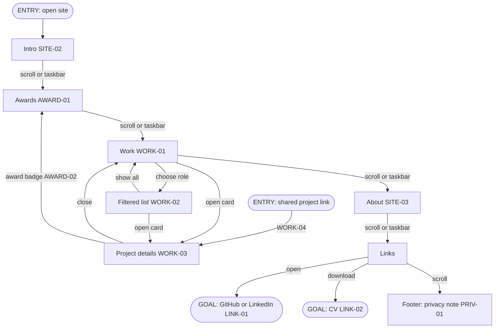

# First Look

Flow and wireframes before styling. Requirements: `docs/PRD.md` 0.5.0. Text in `<angle brackets>` is a labeled placeholder.

## Decisions

### Round 1 (2026-11-24)

- Phone and desktop get equal weight (owner).
- Responsive 90s desktop retro style (owner). Original artwork, no logos (agent proposal).
- References picked by the agent (owner).
- Pixel parity check and legal footer: yes. Wide-screen frames: no (owner).

### Round 2 (2026-11-24)

- Fixed windows on a scrolling page; Download CV in intro and links; owner photo in the intro; structure approved (owner).
- No fake minimize or close buttons, since windows are fixed (agent call).

### Round 3 (2026-11-24)

- Direction B, File explorer, whole (owner).
- Follow the visitor's light or dark setting, plus a toggle (owner). Needs a PRD requirement before planning.
- Desktop: folder tree and a slim taskbar with the current section. Phone and tablet: Menu taskbar (owner).
- Theme toggle sits at the right of the taskbar (agent proposal).

### Lock (2026-11-24)

- Direction B locked at phone, tablet, and desktop widths in both themes (owner).
- Theme toggle stays at the right of the taskbar (owner). PRD 0.3.0 adds THEME-01.
- Heading font changed to Pixelify Sans so names keep their capitalization (owner).
- No ADR for the look: it can be changed later through the tokens.

### Change After Lock (2026-11-25)

- Projects show no outcome; an opened card shows the stack where supplied (owner, PRD 0.5.0).
- Taskvane is now Idiya (owner). The wireframes below are updated.
- The intro strip reads "Frontend developer, project manager" (owner).
- Award and project names use the bold text font (owner).
- On phones, award photos sit small beside their text and the profile photo is 108 by 120 px, to keep NFR-01; award photos open full size (owner). The phone wireframe below shows the earlier full width.

- A failed profile photo shows its description (owner, 2026-11-25).

### Change After Lock (2026-11-25, T11)

- From 900 px the folder tree is removed and its links move into the taskbar, with icons (owner).
- The Copy link button is removed (owner).

### For The Plan Gate

- Pixel parity (owner chose it): Playwright screenshots of `docs/design/board-b.html` and the build at 390, 768, and 1280 px, both themes, structure matching within 8 px.

## App Flow



## Desktop (about 1280 px)

The page scrolls normally. Each section is one window on a desktop background. The taskbar stays at the bottom as section navigation.

```text
+--------------------------------------------------------------------------------------------------+
| (desktop background)                                                                             |
|  +-[ Welcome ]-------------------------------------------------------------------------- _ [] x-+ |
|  |  +-----------+   <Name>                                                                      | |
|  |  | <portrait |   <One-line intro: software development and project management>               | |
|  |  |  or icon> |   [ See my work ]   [ Download CV ]                                           | |
|  |  +-----------+                                                                               | |
|  +-[ Frontend developer, project manager ]------------------------------------------------------+ |
|                                                                                                  |
|  +-[ Awards ]--------------------------------------------------------------------------- _ [] x-+ |
|  |  +--------------------+  <Placement>, <Hackathon>                                            | |
|  |  | <award image>      |  <Organizer>, <date>                                                 | |
|  |  |                    |  Project: <project>   My role: <role>   Team of <n>                  | |
|  |  +--------------------+                                                                      | |
|  +-[ <n> awards ]-------------------------------------------------------------------------------+ |
|                                                                                                  |
|  +-[ Work ]----------------------------------------------------------------------------- _ [] x-+ |
|  |  Show: (o) All  ( ) Software development  ( ) Project management                             | |
|  |  +--------------------------------------+  +--------------------------------------+          | |
|  |  | [+] Idiya                            |  | [+] Alunsina                         |          | |
|  |  |     Development, project management  |  |     Project management               |          | |
|  |  |     Solo project                     |  |     Team of <n>   [* <award badge>]  |          | |
|  |  +--------------------------------------+  +--------------------------------------+          | |
|  |  +--------------------------------------+  +--------------------------------------+          | |
|  |  | [+] UMak Kalinga                     |  |     HeronPay          [ Coming soon ]|          | |
|  |  |     Project management  Team of <n>  |  |     Project management               |          | |
|  |  +--------------------------------------+  +--------------------------------------+          | |
|  |  +--------------------------------------+                                                    | |
|  |  |     eHanda            [ Coming soon ]|                                                    | |
|  |  |     Project management               |                                                    | |
|  |  +--------------------------------------+                                                    | |
|  +-[ 5 projects ]-------------------------------------------------------------------------------+ |
|                                                                                                  |
|  +-[ About ]-------------------------------------+  +-[ Links ]--------------------------------+ |
|  |  <About text from the owner>                  |  |  [icon] GitHub                           | |
|  |                                               |  |  [icon] LinkedIn                         | |
|  |                                               |  |  [icon] Download CV                      | |
|  +-----------------------------------------------+  +------------------------------------------+ |
|  Footer: (c) <year> <Name>    Privacy note                                                       |
+--------------------------------------------------------------------------------------------------+
| [Menu] | Welcome | Awards | Work | About | Links |                                               |
+--------------------------------------------------------------------------------------------------+
```

Open project (pushes the cards below it down, full width of the window):

```text
|  +--------------------------------------------------------------------------------------------+  |
|  | [-] Idiya                                                                                   |  |
|  |     Full-stack developer and project manager, solo project                                 |  |
|  |     Problem:  <owner-checked text>                                                          |  |
|  |     What I did: <owner-checked text>                                                        |  |
|  |     Stack:    <where supplied>                                                              |  |
|  |     <image>   <image>       [ Link: <label> ]                                               |  |
|  +--------------------------------------------------------------------------------------------+  |
```

## Phone (about 390 px)

Windows become full-width panels. The taskbar keeps one Menu button and the current section name.

```text
+--------------------------------------+
| [ Welcome ]----------------- _ [] x  |
|  <portrait or icon>                  |
|  <Name>                              |
|  <One-line intro>                    |
|  [ See my work     ]                 |
|  [ Download CV     ]                 |
+--------------------------------------+
| [ Awards ]------------------ _ [] x  |
|  <award image, full width>           |
|  <Placement>, <Hackathon>            |
|  <Organizer>, <date>                 |
|  Project: <project>                  |
|  My role: <role>, team of <n>        |
+--------------------------------------+
| [ Work ]-------------------- _ [] x  |
|  Show: [ All                  v ]    |
|  +--------------------------------+  |
|  | [+] Idiya                      |  |
|  |  Development, project mgmt     |  |
|  |  Solo project                  |  |
|  +--------------------------------+  |
|  | [+] Alunsina  [* <badge>]      |  |
|  |  Project management            |  |
|  +--------------------------------+  |
|  |     HeronPay   [ Coming soon ] |  |
|  +--------------------------------+  |
|  ...                                 |
+--------------------------------------+
| [ About ]------------------- _ [] x  |
|  <About text>                        |
+--------------------------------------+
| [ Links ]------------------- _ [] x  |
|  [ GitHub          ]                 |
|  [ LinkedIn        ]                 |
|  [ Download CV     ]                 |
+--------------------------------------+
| (c) <year> <Name>   Privacy note     |
+--------------------------------------+
| [Menu]   Work                        |
+--------------------------------------+
```

## Components And States

The page is built ahead of time, so sections have no loading state of their own; only images load.

| Section | Components | Loading | Empty | Error |
| --- | --- | --- | --- | --- |
| Intro | Title bar, name, one-line intro, two buttons | Space kept for the portrait | Labeled placeholder until launch | Missing image shows the icon |
| Awards | Award rows, images | Space kept per image | Section hidden (AWARD-01) | Failed image shows its text description |
| Work | Role filter, cards, badge | Space kept per image | Not expected; both roles have a project | Unknown #link shows the page normally (WORK-04) |
| Project | Problem, what I did, stack where supplied, links, images | As above | "Coming soon" (WORK-06) | Failed image shows its text description |
| About | Text | None | Labeled placeholder until launch | None |
| Links | GitHub, LinkedIn, CV | None | Labeled placeholder until launch | A broken Drive link is Google's page, outside the site |
| Footer | Copyright line, privacy note | None | None | None |
| Not found | Retro message window with a link home | None | None | This is the error state for wrong addresses |
